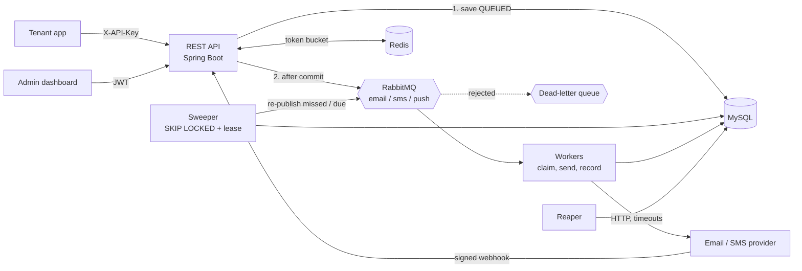

A multi-tenant notification platform. Client apps call one API ("send this user the `welcome` template by email"). NotifyHub decides **whether** to send (user preferences, quiet hours, rate limits), delivers **asynchronously** through RabbitMQ, **retries** failures with backoff, and **tracks delivery** through signed provider webhooks.

**Built with:** Java, Spring Boot 4, MySQL, RabbitMQ, Redis, Flyway, Docker, GitHub Actions, Testcontainers.

## Why it's interesting

Sending a message sounds simple. The hard parts are the failure modes:

| Problem | How NotifyHub handles it |
|---|---|
| Client retries a timed-out request → duplicate email | `Idempotency-Key` + request fingerprint + DB unique constraint |
| Saving to the DB and publishing to the queue can't be atomic | Publish after commit, plus a sweeper that re-publishes anything missed |
| A worker crashes mid-send | Reaper recovers stuck rows; attempts are recorded |
| Provider is down or slow | Timeouts, retryable vs permanent classification, exponential backoff with jitter, dead-letter queue |
| One tenant floods the API | Redis token bucket (atomic Lua script) per tenant and per recipient |
| Several app instances | `SELECT ... FOR UPDATE SKIP LOCKED` plus a lease, so no row is published twice |
| Tenants must never see each other's data | Every query is scoped by tenant, with automated isolation tests |

## Architecture



**Request lifecycle:** `POST /notifications` → validate and check preferences/quiet hours → save as `QUEUED` pinned to an exact template version → return `202 Accepted` → publish after commit → worker claims it (optimistic lock) → calls the provider → records the attempt → `SENT` → webhook moves it to `DELIVERED` or `FAILED`.

**Status machine:** `QUEUED → PROCESSING → SENT → DELIVERED`, with `SKIPPED`, `CANCELLED` and `FAILED` as other terminal states. Illegal transitions are impossible in code.

## Key design decisions and trade-offs

- **Modular monolith, not microservices.** One deployable with clean package boundaries. Splitting later is possible, and until then there is no distributed-systems overhead.
- **The database is the source of truth, the queue is a delivery mechanism.** Messages carry only the id. If a message is lost, the sweeper republishes from the row.
- **At-least-once delivery, idempotent consumers.** Exactly-once is impossible across two systems. Workers claim a row before sending, so duplicate messages are harmless. A crash between "provider accepted" and "we recorded SENT" can still cause one duplicate send, which is documented and accepted.
- **Backoff state lives in the DB (`scheduled_at`), not in RabbitMQ delay queues.** It allows per-message jitter and keeps one source of truth, at the cost of ~2 s timing precision.
- **Immutable template versions.** A notification points at an exact version, so editing a template never changes messages in flight.
- **Rate limiter fails open.** If Redis is down, traffic continues, because the limiter protects the service and isn't the product.
- **Hand-written token bucket (Lua) instead of a library,** to make the atomicity explicit. A real team would likely use Bucket4j.
- **Logic-less template engine.** Tenants write templates, so they are untrusted input. There is nothing to execute, which rules out server-side template injection. Variables are HTML-escaped for email.
- **Webhooks:** HMAC-SHA256 over the raw body, constant-time comparison, timestamp tolerance, event-id deduplication, and state-machine guarding against out-of-order events.

## Run it

```bash
cp .env.example .env        # then put real random secrets in .env (32+ chars)
docker compose --profile app up -d --build --wait
```
- API docs (Swagger UI): http://localhost:8080/swagger-ui/index.html
- Health: http://localhost:8080/actuator/health
- RabbitMQ UI: http://localhost:15672

**Develop locally:** `docker compose up -d` starts only MySQL, RabbitMQ and Redis. Run the app from your IDE.

## Testing

```bash
./mvnw clean test      # needs Docker: Testcontainers starts real MySQL, RabbitMQ and Redis
```
__N__ automated tests: unit tests for the pure logic (retry policy, quiet hours, template renderer, signatures, state machine) and integration tests against real infrastructure, covering delivery end to end, tenant isolation, authentication, the idempotency race (concurrent duplicates → one notification), the Lua rate limiter under parallel load, signed webhooks, and multi-instance sweep claiming. CI runs everything on every push, then builds the Docker image and smoke-tests the full stack.

## Load test (k6, mock provider, single laptop, Docker)

| Rate | p95 latency | Errors | Dropped | Notes |
|---|---|---|---|---|
| __ req/s | __ ms | __ % | __ | |
| __ req/s | __ ms | __ % | __ | |

- **Sustainable throughput:** __ req/s at p95 < 500 ms and < 1% errors.
- **End-to-end delivery:** __ notifications in __ s (accepted → `SENT`).
- **Duplicate deliveries:** 0 across __ notifications (verified in the database).
- **Idempotency under concurrency:** 0 violations in __ concurrent duplicate pairs.
- **Bottleneck found:** __ (and what changed when I tuned it).

*Caveats:* the provider is a mock, so this measures the accept path, database, queue and workers, not real email delivery. k6, MySQL and RabbitMQ shared one laptop.

## Security

API keys are stored as SHA-256 hashes (shown once). Passwords use BCrypt. JWT access tokens are short-lived, with rotating, hashed refresh tokens and reuse detection. Strict security headers, per-IP login throttling, admin-only metrics, no personal data in logs, secrets only from environment variables, and a non-root container.

## Known limitations and future work

- Mock SMS and push providers (the email adapter is written against SendGrid's API and tested with a local fake server). Only the provider interface is real for SMS and push.
- No OpenTelemetry tracing (a correlation id ties logs together).
- Tenant rate limit charges one token per HTTP request, so a batch of 100 costs one token.
- Idempotency keys never expire. Old payloads aren't purged or encrypted at rest.
- Webhook secret rotation, a DLQ replay endpoint, and cursor signing are not implemented.
- Single MySQL instance, no read replicas or partitioning.
